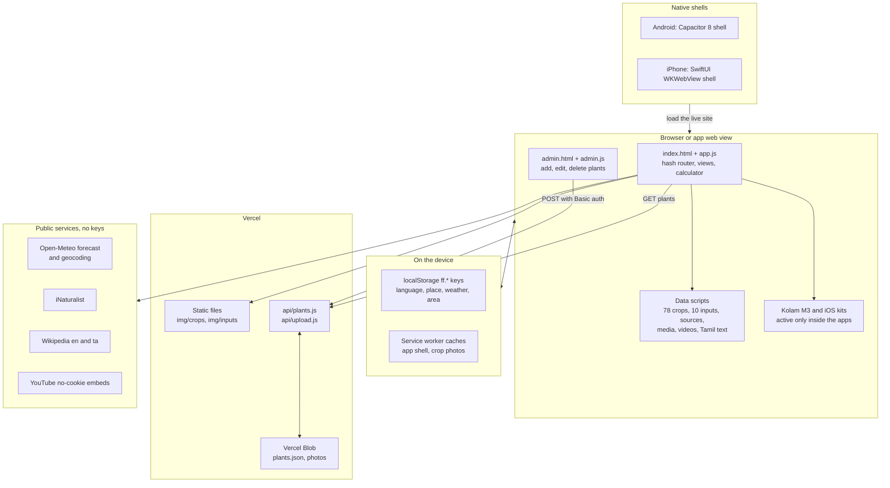
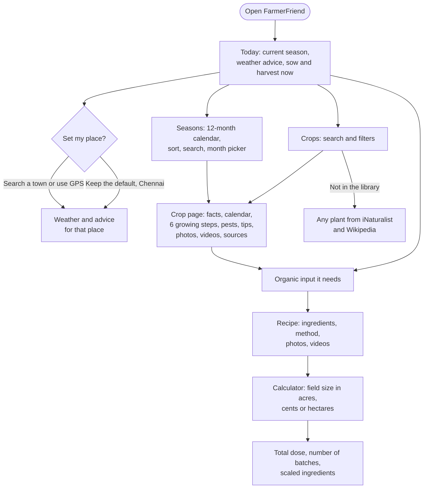
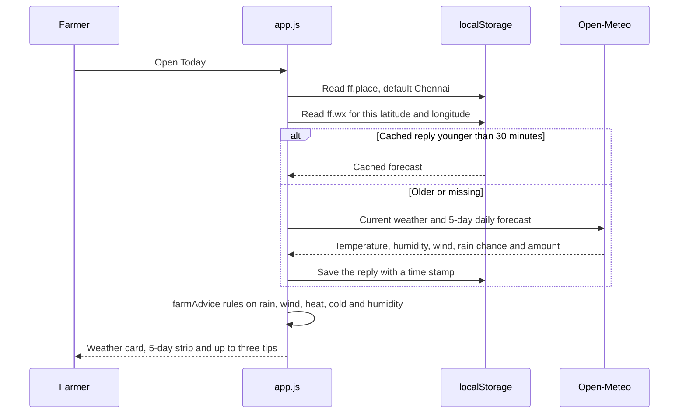
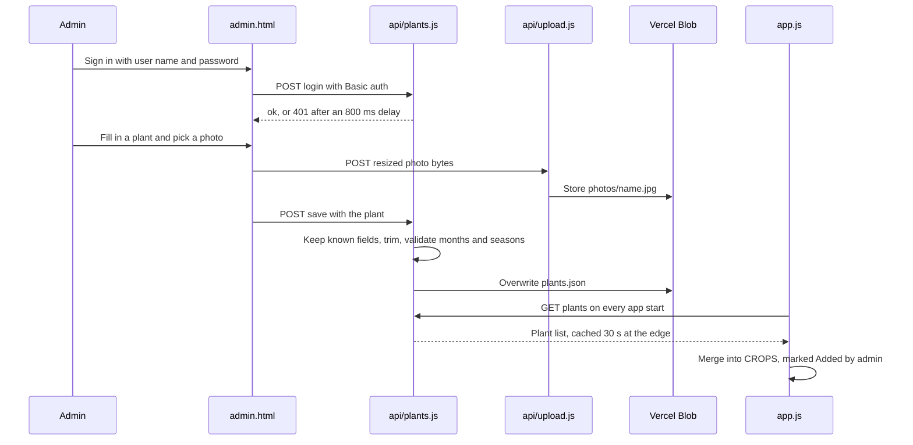
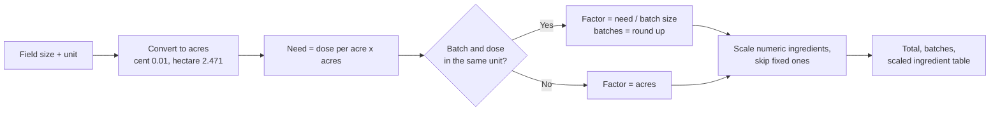
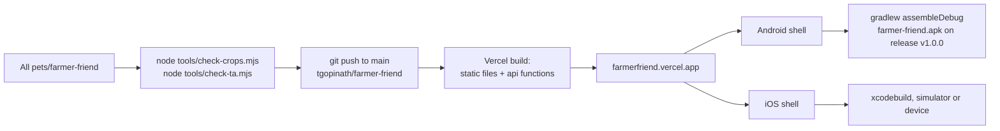

# FarmerFriend (விவசாயி நண்பன்)

FarmerFriend is a farming guide for Indian smallholders, in English and Tamil. It answers three everyday questions: what should I plant this month (Kharif, Rabi or Zaid season), how do I grow this crop (78 crops with steps, pests, photos and videos), and how do I make my own organic inputs (10 recipes, each with a field-size calculator). Live weather from Open-Meteo turns into plain farm advice. The design and engineering idea is "a trustworthy reference that works on a cheap phone": hand-written, fact-checked data shipped as plain script files, no build step, an offline service worker, and a small admin API so new plants can be added without a code change.

| Platforms | Stack | Data | Hosting |
|---|---|---|---|
| Web PWA, Android app (Capacitor shell), iPhone app (SwiftUI shell) | Plain HTML, CSS and classic scripts; two Vercel Functions; Kolam tokens | Hand-written crop and recipe data, Open-Meteo, iNaturalist, Wikipedia, YouTube, Vercel Blob | Vercel (farmerfriend.vercel.app), APK on GitHub Releases |

## System architecture

The app is a single page (`index.html`) that loads about twenty classic `<script>` files in order: photo and media lists, crop and recipe data, the source list, Tamil translations, interface text, then `app.js`. Each data file sets a global (`CROPS`, `COMPOSTS`, `SEASONS`, `MEDIA`, `VIDEOS`, `SOURCES`, `CROPS_TA` and so on), and `app.js` reads them. The only server code is in `api/`: a public read endpoint and two admin-only write endpoints that keep admin-added plants and their photos in Vercel Blob.

*All farming knowledge ships with the page; the network is only needed for weather, any-plant search, videos and admin-added plants.*

## Main user flow

The core job is "tell me what to do on my farm this month". The Today screen opens on the current season, live weather for the farmer's place with up to three pieces of advice, and lists of crops to sow now, harvest now and get ready for next month. From any crop the farmer reaches the growing steps and the organic inputs that crop needs, then the recipe and its calculator.

*The English and தமிழ் switch works on every screen; the other language's name always shows as a subtitle.*

## Data flow and state

### Weather advice

*The rules are simple thresholds, for example a 60 percent rain chance or 10 mm over two days means "hold off spraying and manure, clear field drains", and 36 degrees or more is a heat warning. If the request fails and there is no cache, the card says so.*

### Language switching

English data is cloned once at start-up (`BASE`). Switching to Tamil copies the Tamil text from `data-ta-*.js` over the same `CROPS` and `COMPOSTS` objects, so every view keeps reading one data shape. Numbers stay in the English source: `tools/check-ta.mjs` checks that every Tamil string carries the same numbers, so doses and the calculator never drift.

### Admin-added plants

*The admin credentials are checked against two environment variables, `ADMIN_USER` and `ADMIN_PASSWORD`, set only in the Vercel project. The browser keeps the encoded credentials in `sessionStorage` for that tab only.*

### Where state lives

| Store | Key or name | What it holds |
|---|---|---|
| localStorage | `ff.lang` | English or Tamil |
| localStorage | `ff.place` | Chosen place or "My farm" from GPS (rounded to 3 decimals) |
| localStorage | `ff.wx.<lat>,<lon>` | Last forecast for that place, with a time stamp |
| localStorage | `ff.area` | Last field size and unit in the calculator |
| localStorage | `ff.customPlants` | Last admin plant list, so it shows offline |
| sessionStorage | `ffAdmin` | Admin sign-in for the current tab |
| Cache Storage | `ff-shell-v12-ios`, `ff-img-v1` | App files, fonts and Kolam kits; local crop images and iNaturalist photos |
| Vercel Blob | `plants.json`, `photos/*` | Admin-added plants and their photos |

## Key modules

| File / module | Responsibility |
|---|---|
| `index.html` | Header with place and language buttons, tabs, the place sheet and photo lightbox dialogs, loads every script |
| `app.js` | About 900 lines: hash router, Today, Seasons calendar, Crops, crop page, Organic, recipe page with calculator, sources report, any-plant search, admin-plant merge, Android and iOS app modes |
| `data-crops.js`, `data-crops-more-1..4.js` | 30 original crops plus 48 added later: seasons, sowing and harvest months, soil, water, spacing, seed rate, yield, steps, pests, tips |
| `data-compost.js` | 10 organic inputs (vermicompost, NADEP, pit compost, Jeevamrutham, Beejamrutham, Panchagavya, Neemastra, fish amino acid, green manure, waste decomposer) with batch size, dose and ingredients |
| `data-ta-crops-1/2.js`, `data-ta-compost.js`, `i18n.js`, `captions-ta.js` | Tamil crop and recipe text, interface text in both languages, Tamil photo captions |
| `sources.js` | References per crop and input (TNAU, ICAR, NHB, MANAGE, state departments) and the fact-check report |
| `images.js`, `images-local.js`, `media*.js`, `videos*.js` | Main photo per crop, local thumbnails, gallery and pest photos, vetted YouTube videos |
| `api/_store.js`, `api/plants.js`, `api/upload.js` | Blob read and write, Basic-auth check with constant-time compare, plant validation, photo upload (JPEG, PNG or WebP, up to 4 MB) |
| `sw.js` | Network first for app files with cache fallback; cache first for images |
| `tools/` | `check-crops.mjs` and `check-ta.mjs` validate data; `fetch-images.mjs` and `local-thumbs.mjs` pin and copy photos; `captions.mjs` lists missing Tamil captions; `shots.mjs` takes portfolio screenshots |

### The calculator

Each recipe has a batch (for example 200 litres of Jeevamrutham) and a dose per acre. The farmer types a field size in acres, cents or hectares; the app works out the total dose, how many batches to make, and scales every ingredient that has a number, except fixed ones like a starter handful or a base layer.

## Platforms

### Web and PWA

The website uses Kolam design tokens (`kolam/tokens.css`, Lato with Noto Sans Tamil) with FarmerFriend's own styles on top. It installs as a PWA from `manifest.json` and keeps working offline after the first visit.

### Android app

A Capacitor 8 remote shell in `android-wrappers/farmer-friend` (app id `com.gopinath.farmerfriend`) that loads the live site and declares fine and coarse location permissions for "Use my location". Inside it the Kolam M3 kit sets `html.k-android`; `app.js` adds a Material 3 top app bar with place and language actions, a navigation bar (Today, Seasons, Crops, Organic) and Back targets for detail pages.

### iPhone app

A SwiftUI `WKWebView` shell in `FarmerFriend-iOS` from the Kolam iOS template: `FarmerFriend-iOS` in the user agent, inline media, edge-swipe back, outside links in `SFSafariViewController`, haptics from the page and a native offline screen. The Kolam iOS kit sets `html.k-ios`; `app.js` sets large titles on the four tabs and Back plus a centred title on crop, plant and recipe pages.

## Data sources and APIs

| Source | Used for | Licence / key |
|---|---|---|
| Hand-written data | Crops, seasons, recipes, doses, steps and tips | Written from TNAU, ICAR, NHB and Government of India guides; checked as described below |
| Open-Meteo | Forecast and place search | Free, no key |
| iNaturalist | Crop photos (pinned), gallery and pest photos, any-plant search and pages | Free, no key; photo licences and credits shown |
| Wikimedia Commons | Hand-picked produce photos where iNaturalist showed wild plants | Free; credited |
| Wikipedia (en, ta) | Summaries for any-plant pages, Tamil search through language links | Free, no key |
| YouTube | Vetted "how to" videos, embedded from youtube-nocookie.com only when tapped | Free embeds |
| Vercel Blob | Admin-added plants and photos | Vercel project storage |

The original 30 crops and 10 inputs were fact-checked claim by claim: 506 claims, 312 correct, 112 approximately right, 20 wrong (all fixed) and 62 that could not be verified. The report is in the app at `#/sources`. The 48 later crops carry their own source links but were not part of that count.

## Offline, performance, privacy and accessibility

- **Offline:** every app file is cached on install. App files are fetched from the network first and fall back to the cache, so updates show at once when online; images are served from the cache first.
- **Speed:** crop grid thumbnails are local 420 px copies in `img/crops`, because Wikimedia rate-limits bursts of hot-linked images. Videos load only when tapped (a thumbnail first, then the embed).
- **Privacy:** no accounts for farmers and no analytics. The farmer's location is stored only on the device, rounded, and sent only to Open-Meteo for the forecast.
- **Admin security:** Basic auth over HTTPS, constant-time comparison of hashed values, an 800 ms delay on a wrong password, and strict field cleaning on the server.
- **Accessibility:** semantic dialogs for the place sheet and lightbox, `aria-label`s that follow the language, the forecast strip labelled for screen readers, and Tamil text marked with `lang` so it gets the Tamil font.

## Build and deploy

There is no build step. The GitHub repository is connected to Vercel, so a push to `main` deploys production. The Android APK and the iPhone app are thin shells, so they pick up web changes without a rebuild.

*The only runtime dependency is `@vercel/blob`, used by the API functions.*

## Known limits and next steps

- The Android shell's Capacitor config still points at the older alias `farmer-friend-kappa.vercel.app` rather than `farmerfriend.vercel.app`; it works while that alias stays, but should be updated on the next APK build.
- Advice rules are general thresholds, not crop-specific; the app says so and points farmers to their local KVK.
- Climate figures make up most of the 62 unverified claims, and the 48 later crops have not had the same claim-by-claim check.
- Admin plants are stored as one JSON file, which is fine for a handful of editors but has no edit history or conflict handling.
- The APK is a debug build, installed by side-loading.

---

Written from the source code on 17 November 2026. Source: [github.com/tgopinath/farmer-friend](https://github.com/tgopinath/farmer-friend) (web app) and [github.com/tgopinath/FarmerFriend-iOS](https://github.com/tgopinath/FarmerFriend-iOS) (iPhone shell).
