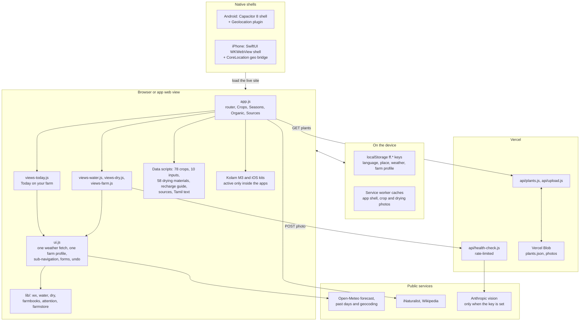
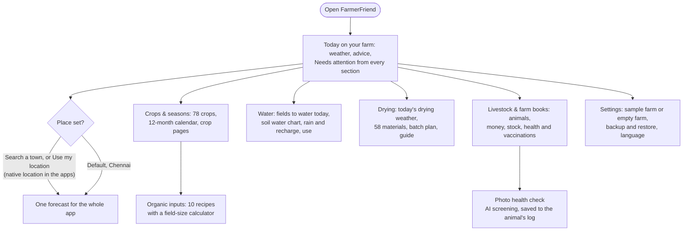
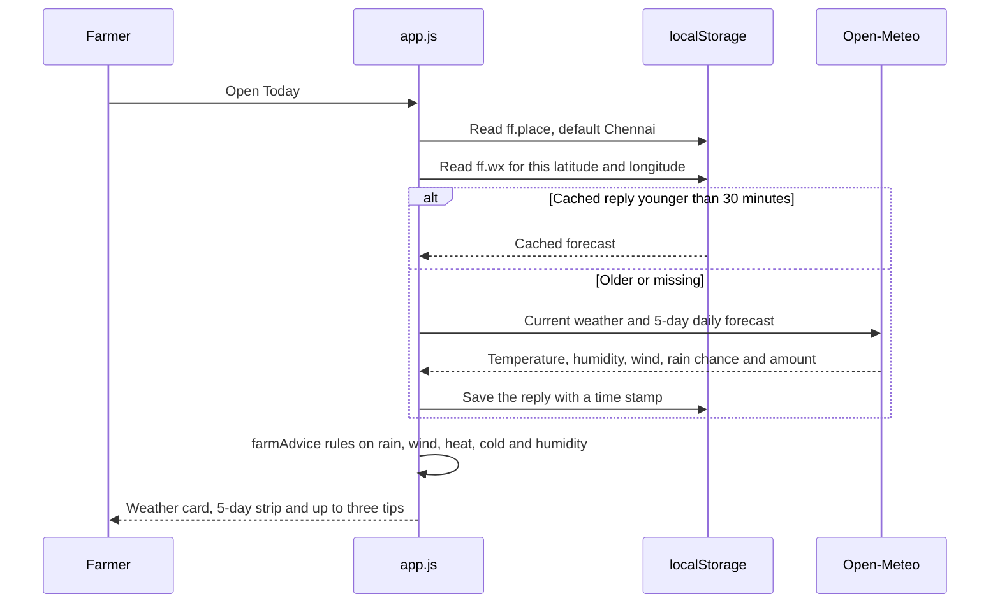
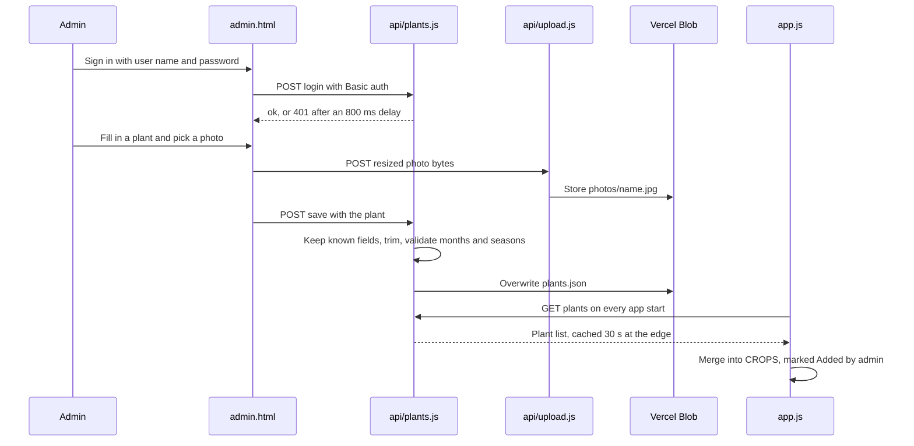
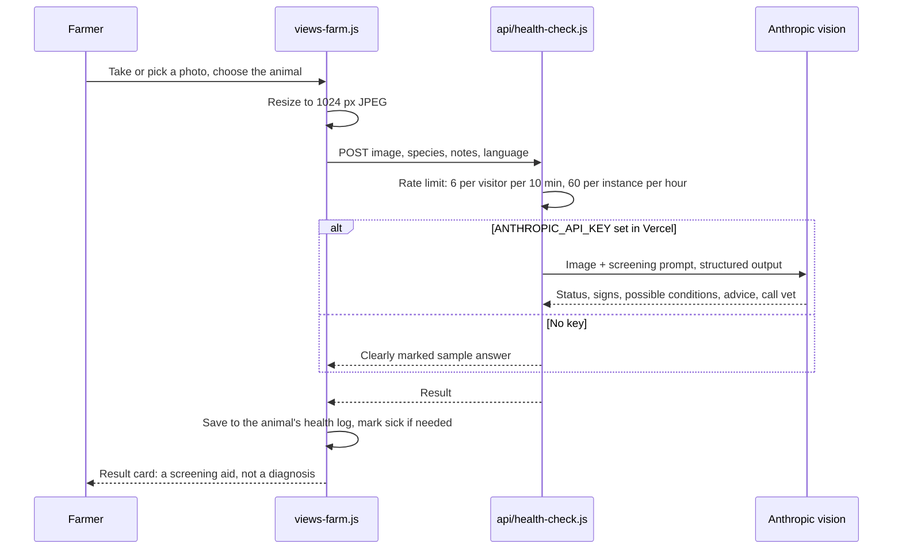
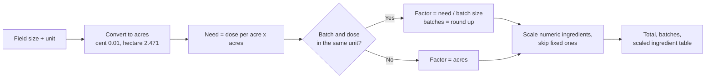
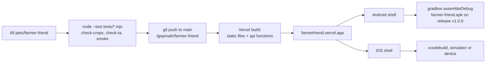

# FarmerFriend (விவசாயி நண்பன்)

FarmerFriend is one farm app for Indian smallholders, in English and Tamil. Since November 2026 it combines four apps that used to be separate: FarmerFriend (crops, seasons and organic inputs), Water Manager (irrigation and borewell recharge), Solar Dry House (drying produce) and Farm Manager (livestock and farm books). The home screen, "Today on your farm", puts the weather and one ranked "Needs attention" list from every section on one page. The design and engineering idea is "a trustworthy reference that works on a cheap phone": hand-written, fact-checked data shipped as plain script files, no build step, an offline service worker, one shared place, weather fetch and farm profile, and small server routes only where a key or shared storage is needed.

| Platforms | Stack | Data | Hosting |
|---|---|---|---|
| Web PWA, Android app (Capacitor shell with native location), iPhone app (SwiftUI shell with native location) | Plain HTML, CSS and classic scripts; three Vercel Functions; Kolam tokens | Hand-written crop, recipe, drying and recharge data, Open-Meteo, iNaturalist, Wikipedia, YouTube, Vercel Blob, Anthropic (health check) | Vercel (farmerfriend.vercel.app), APK on GitHub Releases |

## System architecture

The app is a single page (`index.html`) that loads classic `<script>` files in order: photo and media lists, crop, recipe, water and drying data, the source list, Tamil translations, interface text (`i18n.js`, `i18n-more.js`), the pure logic modules in `lib/`, then `app.js`, the shared pieces in `ui.js`, one view file per new section and `boot.js`. Each data file sets a global, and the views read them. Server code lives in `api/`: the admin-plant endpoints (Vercel Blob) and the photo health check (Anthropic, key only in the Vercel environment).

*All farming knowledge ships with the page; the network is only needed for weather, any-plant search, videos, admin-added plants and the AI health check.*

## Main user flow

The core job is "tell me what to do on my farm today". The home screen shows the date, the weather with farm advice, one ranked list of what needs attention across every section (overdue vaccinations, a stressed field, low feed, a cash box below its minimum, rain on the way, a good drying day), a glance at each section and this month's sowing and harvest. Every item has one action button that either does the job (Mark given) or opens the right screen.

*There are five tabs (Today, Crops, Water, Drying, Farm); Organic inputs and Seasons sit inside Crops. The English and தமிழ் switch works on every screen, and every tab label fits in Tamil in the Material 3 and iOS tab bars (`tools/smoke.mjs` fails on a clipped label).*

## Data flow and state

### One weather fetch

`lib/wx.js` asks Open-Meteo once per place for current weather, 30 past days (for the soil water balance) and 16 days ahead (for advice and drying dates). Today, Water and Drying all read the same reply, cached for an hour.

*The rules are simple thresholds, for example a 60 percent rain chance or 10 mm over two days means "hold off spraying and manure, clear field drains", and 36 degrees or more is a heat warning. If the request fails and there is no cache, the card says so.*

### Language switching

English data is cloned once at start-up (`BASE`). Switching to Tamil copies the Tamil text from `data-ta-*.js` over the same `CROPS` and `COMPOSTS` objects, so every view keeps reading one data shape. Numbers stay in the English source: `tools/check-ta.mjs` checks that every Tamil string carries the same numbers, so doses and the calculator never drift.

### Admin-added plants

*The admin credentials are checked against two environment variables, `ADMIN_USER` and `ADMIN_PASSWORD`, set only in the Vercel project. The browser keeps the encoded credentials in `sessionStorage` for that tab only.*

### Water: daily soil water balance

`lib/water.js` (from Water Manager) runs an FAO-56 single crop coefficient balance per field: reference evapotranspiration from the forecast, a crop coefficient for the crop's stage, effective rain, and the field's last watering. The result is one status per field (water now, water today, hold for rain, fine) with litres and pump hours, and the 7-day chart on the field page. Rain and recharge turns the forecast into a catchment estimate and the before-rain checklist for the borewell recharge pit.

### Drying: ready dates from the forecast

`lib/dry.js` (from Solar Dry House) converts moisture to a dry-weight basis, follows each material's drying curve to the target moisture (3 percent by default, or the safe storage level when 3 percent is out of reach), and adds up day factors from the forecast (sun, humidity, cloud and the estimated inside temperature of the dry house) to give a ready date and the best morning to load. The batch plan gives water to remove, dried weight, tray area and days.

### Livestock & farm books

`lib/farmbooks.js` is a port of Farm Manager's `summary.js` with the same data model and rules: account balances from transactions, feed and stock days left from the daily use, upkeep due dates, vaccinations, and the ranked reminders (overdue, act soon, this week, then by date). Reminders carry codes and numbers, not sentences, so `i18n-more.js` renders them in English or Tamil.

### Today on your farm: Needs attention

`lib/attention.js` merges every section's items into one list with four levels: act now, today, this week, information. Farm Manager's ranking is kept and extended: a stressed field ranks with overdue items, a field to water today with "today", rain on the way with "this week", and a good drying day or crops to sow come last.

### Where state lives

| Store | Key or name | What it holds |
|---|---|---|
| localStorage | `ff.lang` | English or Tamil |
| localStorage | `ff.place` | Chosen place or "My farm" from GPS (rounded to 3 decimals) |
| localStorage | `ff.wx.<lat>,<lon>` | Last forecast for that place, with a time stamp |
| localStorage | `ff.area` | Last field size and unit in the calculator |
| localStorage | `ff.farm` | The one farm profile: fields, water sources, watering logs, catchments, animals, health log, vaccinations, money, accounts, stock and upkeep (sample farm until the farmer starts an empty one; backup and restore in Settings) |
| localStorage | `ff.dryTarget`, `ff.dryArea` | Drying target moisture and tray area |
| localStorage | `ff.customPlants` | Last admin plant list, so it shows offline |
| sessionStorage | `ffAdmin` | Admin sign-in for the current tab |
| Cache Storage | `ff-shell-v13-combined`, `ff-img-v2` | App files, fonts and Kolam kits; local crop and drying images and iNaturalist photos. `/api/` is never cached |
| Vercel Blob | `plants.json`, `photos/*` | Admin-added plants and their photos |

## Key modules

| File / module | Responsibility |
|---|---|
| `index.html` | Header with place and language buttons, tabs, the place sheet and photo lightbox dialogs, loads every script |
| `app.js` | Hash router, Seasons calendar, Crops, crop page, Organic, recipe page with calculator, sources report, any-plant search, admin-plant merge, Android and iOS app modes (tab bar, top bar, Back targets) |
| `views-today.js` | Today on your farm: weather, advice, Needs attention, section glance, sow and harvest now |
| `views-water.js`, `views-dry.js`, `views-farm.js` | Water, Drying and Livestock & farm books sections, each with its own sub-navigation |
| `ui.js`, `boot.js` | Shared weather and farm profile, number and date formatting per language, sub-navigation, form dialog, undo toast; start-up |
| `lib/wx.js`, `lib/water.js`, `lib/dry.js`, `lib/farmbooks.js`, `lib/attention.js`, `lib/farmstore.js` | Pure logic, tested in `tests/lib.test.mjs` |
| `data-water.js`, `data-dry.js`, `data-ta-water.js`, `data-ta-dry.js`, `i18n-more.js` | Recharge guide, 58 drying materials and the new sections' text in English and Tamil |
| `geo-bridge.js` | Inside the Android app, answers `navigator.geolocation` with Capacitor's Geolocation plugin |
| `api/health-check.js` | Photo health check: Anthropic vision with structured output, demo answer without a key, rate-limited |
| `data-crops.js`, `data-crops-more-1..4.js` | 30 original crops plus 48 added later: seasons, sowing and harvest months, soil, water, spacing, seed rate, yield, steps, pests, tips |
| `data-compost.js` | 10 organic inputs (vermicompost, NADEP, pit compost, Jeevamrutham, Beejamrutham, Panchagavya, Neemastra, fish amino acid, green manure, waste decomposer) with batch size, dose and ingredients |
| `data-ta-crops-1/2.js`, `data-ta-compost.js`, `i18n.js`, `captions-ta.js` | Tamil crop and recipe text, interface text in both languages, Tamil photo captions |
| `sources.js` | References per crop and input (TNAU, ICAR, NHB, MANAGE, state departments) and the fact-check report |
| `images.js`, `images-local.js`, `media*.js`, `videos*.js` | Main photo per crop, local thumbnails, gallery and pest photos, vetted YouTube videos |
| `api/_store.js`, `api/plants.js`, `api/upload.js` | Blob read and write, Basic-auth check with constant-time compare, plant validation, photo upload (JPEG, PNG or WebP, up to 4 MB) |
| `sw.js` | Network first for app files with cache fallback; cache first for images |
| `tools/` | `check-crops.mjs` and `check-ta.mjs` validate data; `fetch-images.mjs` and `local-thumbs.mjs` pin and copy photos; `captions.mjs` lists missing Tamil captions; `shots.mjs` takes portfolio screenshots; `smoke.mjs` opens every screen in English and Tamil, at 390 and 1440 px, in the web, Android and iOS looks, and fails on console errors, sideways overflow or clipped tab labels |

### The calculator

Each recipe has a batch (for example 200 litres of Jeevamrutham) and a dose per acre. The farmer types a field size in acres, cents or hectares; the app works out the total dose, how many batches to make, and scales every ingredient that has a number, except fixed ones like a starter handful or a base layer.

## Platforms

### Web and PWA

The website uses Kolam design tokens (`kolam/tokens.css`, Lato with Noto Sans Tamil) with FarmerFriend's own styles on top. It installs as a PWA from `manifest.json` and keeps working offline after the first visit.

### Android app

A Capacitor 8 remote shell in `android-wrappers/farmer-friend` (app id `com.gopinath.farmerfriend`) that loads https://farmerfriend.vercel.app with the Capacitor Geolocation plugin and fine and coarse location permissions; `geo-bridge.js` routes the page's location requests to it, so Water and Drying use the device's location. Inside it the Kolam M3 kit sets `html.k-android`; `app.js` adds a Material 3 top app bar with place and language actions, a navigation bar (Today, Crops, Water, Drying, Farm) and Back targets for detail pages.

### iPhone app

A SwiftUI `WKWebView` shell in `FarmerFriend-iOS` from the Kolam iOS template: `FarmerFriend-iOS` in the user agent, inline media, edge-swipe back, outside links in `SFSafariViewController`, haptics from the page, a native offline screen, and a CoreLocation geo bridge (the same as Solar Dry House's) that answers `navigator.geolocation` with one iOS permission prompt. The Kolam iOS kit sets `html.k-ios`; `app.js` sets large titles on the five tabs and Back plus a centred title on detail pages.

## Data sources and APIs

| Source | Used for | Licence / key |
|---|---|---|
| Hand-written data | Crops, seasons, recipes, doses, steps and tips | Written from TNAU, ICAR, NHB and Government of India guides; checked as described below |
| Open-Meteo | Forecast, 30 past days, radiation and place search | Free, no key |
| FAO-56 method, Water Manager and Solar Dry House data | Soil water balance, recharge guidance, drying figures (typical guide values) | Hand-written, carried over from the source apps |
| Anthropic | Photo health check (vision, structured output) | `ANTHROPIC_API_KEY` in the Vercel project only; model from `FARM_AI_MODEL` |
| iNaturalist | Crop photos (pinned), gallery and pest photos, any-plant search and pages | Free, no key; photo licences and credits shown |
| Wikimedia Commons | Hand-picked produce photos where iNaturalist showed wild plants | Free; credited |
| Wikipedia (en, ta) | Summaries for any-plant pages, Tamil search through language links | Free, no key |
| YouTube | Vetted "how to" videos, embedded from youtube-nocookie.com only when tapped | Free embeds |
| Vercel Blob | Admin-added plants and photos | Vercel project storage |

The original 30 crops and 10 inputs were fact-checked claim by claim: 506 claims, 312 correct, 112 approximately right, 20 wrong (all fixed) and 62 that could not be verified. The report is in the app at `#/sources`. The 48 later crops carry their own source links but were not part of that count.

## Offline, performance, privacy and accessibility

- **Offline:** every app file is cached on install. App files are fetched from the network first and fall back to the cache, so updates show at once when online; images are served from the cache first.
- **Speed:** crop grid thumbnails are local 420 px copies in `img/crops`, because Wikimedia rate-limits bursts of hot-linked images. Videos load only when tapped (a thumbnail first, then the embed).
- **Privacy:** no accounts for farmers and no analytics. The farmer's location and farm books are stored only on the device; the location is rounded and sent only to Open-Meteo. A health-check photo is sent to the server only when the farmer asks for a check, and is not stored there.
- **Admin security:** Basic auth over HTTPS, constant-time comparison of hashed values, an 800 ms delay on a wrong password, and strict field cleaning on the server.
- **Accessibility:** semantic dialogs for the place sheet and lightbox, `aria-label`s that follow the language, the forecast strip labelled for screen readers, and Tamil text marked with `lang` so it gets the Tamil font.

## Build and deploy

There is no build step. The GitHub repository is connected to Vercel, so a push to `main` deploys production. The Android APK and the iPhone app are thin shells, so they pick up web changes without a rebuild.

*Runtime dependencies are only for the API functions: `@vercel/blob`, `@anthropic-ai/sdk` and `zod`.*

## Known limits and next steps

- Farm books live on one device; there is no sync between phones yet (Farm Manager's Catalyst server was not carried over). Backup and restore is a JSON file from Settings.
- The health check's rate limit is per server instance; the hard cap is the API key's own spend limit.
- Water and drying figures are typical guide values, not measurements from the farmer's own field or dryer.
- Advice rules are general thresholds, not crop-specific; the app says so and points farmers to their local KVK.
- Climate figures make up most of the 62 unverified claims, and the 48 later crops have not had the same claim-by-claim check.
- Admin plants are stored as one JSON file, which is fine for a handful of editors but has no edit history or conflict handling.
- The APK is a debug build, installed by side-loading.

---

Written from the source code on 17 November 2026, updated for the combined app on 20 November 2026. Source: [github.com/tgopinath/farmer-friend](https://github.com/tgopinath/farmer-friend) (web app) and [github.com/tgopinath/FarmerFriend-iOS](https://github.com/tgopinath/FarmerFriend-iOS) (iPhone shell).
